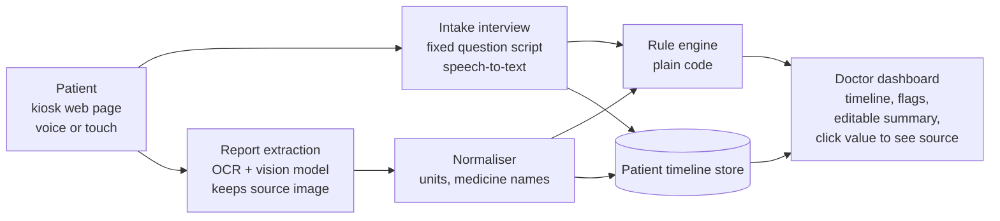

# 03 Architecture

Design rule: **the AI model reads and asks; plain code decides what is flagged.** Every safety decision is made by fixed, explainable rules, never by the language model.

## System flow

## Components

| Component | Responsibility | Notes |
|---|---|---|
| Kiosk web app | Language choice, report photo upload, interview, on-screen confirmation of every answer | Runs in a browser on any tablet, phone or laptop |
| Intake interview | Asks a fixed script of questions and records answers | The script is fixed so behaviour is predictable. The model may rephrase for clarity but may not add medical questions or advice. |
| Speech-to-text | Turns spoken Hindi/English answers into text | Always followed by on-screen confirmation |
| Report extraction | Reads values, dates, units and medicines from photos | Stores for each value the page and the region (bounding box) it came from |
| Normaliser | Converts units (mmol/L and mg/dL), maps brand names to generic medicine names, standardises dates | Deterministic tables and code, not the model |
| Rule engine | Urgent-symptom flags and missing-data checks | Plain code with rules listed in a reviewable file |
| Timeline store | Holds observations, medicines and intake answers per patient | Synthetic data only during the hackathon |
| Doctor dashboard | Shows timeline chart, medicines, flags, missing items and an editable summary | Every value links to its source image region |

## Data model (sketch)

| Entity | Key fields |
|---|---|
| Patient | id (synthetic), age band, language |
| Document | id, patient, type (lab report / prescription), source image, upload time |
| Observation | patient, test, value, unit, normalised value, date, document, page, bounding box, confidence, verified-by-clinician flag |
| Medication | patient, name as written, generic name, dose, frequency, document or intake source |
| IntakeAnswer | patient, question id, raw answer, confirmed-by-patient flag |
| Flag | patient, rule id, severity, evidence (answer or observation ids), time |
| Summary | patient, generated text, clinician edits, version |

## Rules (draft, needs clinician review before use)

**Urgent-symptom flags** (examples only): symptoms of low blood sugar (shakiness, sweating, confusion, fainting), chest pain, severe breathlessness, new vision loss, a foot wound that is not healing, persistent vomiting with high thirst. Each flag shows the patient's own words that triggered it.

**Missing-data checks** (draft thresholds): no HbA1c in the last 3 months; no kidney test (creatinine/eGFR or urine albumin-creatinine ratio) in the last 12 months; no lipid profile in the last 12 months; medicines mentioned by the patient but not found in any prescription; dates or units that could not be read.

The thresholds and symptom list above are drafts from general knowledge. A doctor must review and approve them before we present them as clinically sound.

## Technology (open-source first)

| Layer | Planned choice | Caveat |
|---|---|---|
| Speech-to-text | Whisper, or AI4Bharat Indic speech models | Hindi accuracy must be tested early. Open models can be weaker than commercial services. |
| Report OCR | PaddleOCR (alternatively Tesseract) | Quality drops on blurred or rotated photos |
| Report understanding | An open vision-language model for layout and field extraction | Choose after testing on our synthetic set |
| Backend | FastAPI (Python) | |
| Database | PostgreSQL | |
| Frontend | React | |
| Charts | Any open-source chart library | |

Licences differ between "open source" and "open weights" models. Check each model's licence before saying "fully open source" in public.

## Source-linking

Every extracted value stores its document, page and bounding box. The dashboard shows a crop of that region beside the value so the doctor can verify it in one click. This is the main defence against extraction mistakes.
